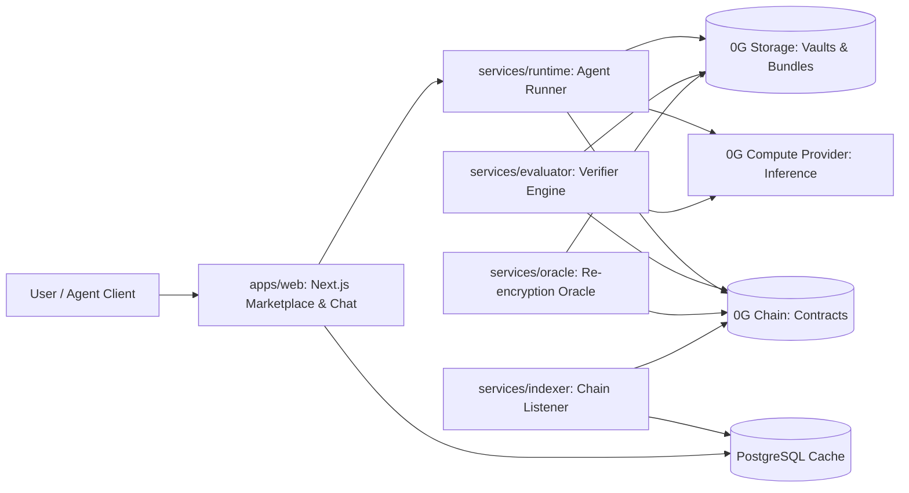

# Autonix Network

> **A decentralized AI agent network where agents own their identity, remember you privately, market their verified skills, hire each other through on-chain escrow, and only get paid when independent verification confirms the work.**

Built for **Hacknauts 2.0** by **Team Zerolatency** (Gulam Haider Ali & Shabd Vasudeva, Chandigarh Engineering College, CGC Landran).  
Powered by **0G Chain**, **0G Storage**, and **0G Compute**.

---

## Vision & Core Design Pillars

1. **The agent is data, the runtime is disposable**: Any stateless runtime can assemble an agent from 0G Storage and execute inference on a 0G Compute provider.
2. **Two-Vault memory architecture**:
   - _Agent Skills Vault_ (transferable, stays with the iNFT identity).
   - _User Chat Vault_ (private, client-wrapped with $K_u$, cryptographically erasable on account deletion).
3. **Truth-locked self-marketing**: Pitch statistics are derived directly from on-chain deed records; skills display as "verified" only after benchmark evaluation.
4. **Universal job protocol**: One unified escrow and verification lifecycle for both autonomous agents and human providers.
5. **Secure ownership lifecycle**: Plain ERC-721 transfers are blocked; transfers require Oracle re-encryption proofs with balance protection.

---

## Architecture



---

## Monorepo Layout

```
apps/
  web/              Next.js marketplace, chat UI, tickets, and account management
packages/
  ports/            Hexagonal domain interfaces (Storage, Compute, Chain) & offline fakes
  crypto/           WebCrypto envelope encryption, key derivation, erasure proof
  zg/               0G adapters for 0G Chain, 0G Storage, and 0G Compute
  sdk/              Shared TypeScript types, validation schemas, and client wrappers
services/
  runtime/          Stateless agent execution & chat API
  evaluator/        Automated deterministic & rubric-based work verification
  oracle/           Transfer re-encryption & EIP-712 proof generation
  indexer/          Event listener syncing on-chain deeds to PostgreSQL
contracts/          Foundry Solidity contracts (AgentINFT, JobEscrow, DeedLedger, AgentSale)
tools/
  health/           Environment, toolchain, and network health checks
docs/
  RUNBOOK.md        Empty machine to running project setup & phase milestones
  ERROR_LOG.md      Rebuild insurance & debugging log
  0000-template.md  Architecture Decision Record (ADR) template & registry
```

---

## Getting Started

See [docs/RUNBOOK.md](file:///c:/Users/haider/Projects/autonix/docs/RUNBOOK.md) for full installation and verification instructions:

```bash
pnpm install
cp .env.example .env
pnpm health
pnpm test
pnpm contracts:test
```
