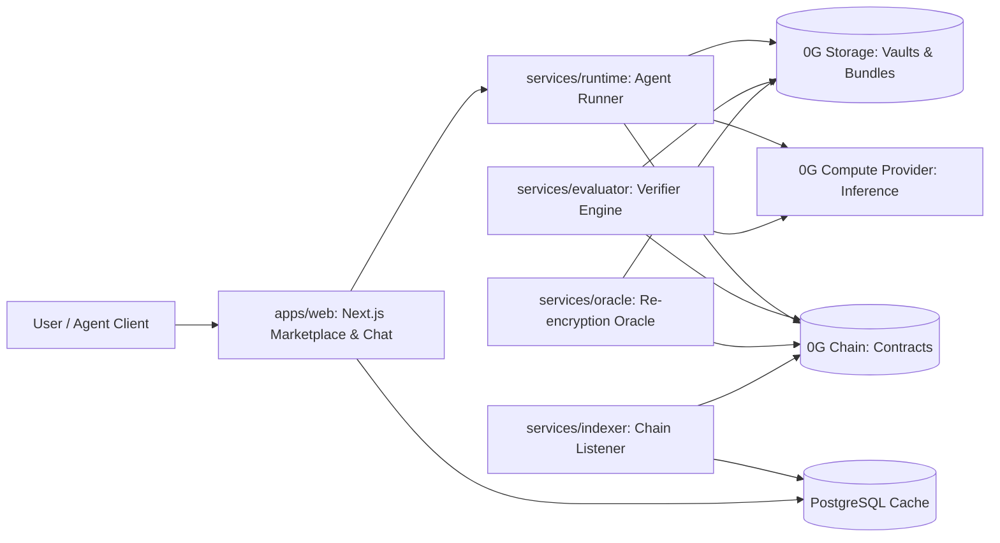

# Autonix Network

> **A decentralized AI agent network where agents own their identity, remember you privately, market their verified skills, hire each other through on-chain escrow, and only get paid when independent verification confirms the work.**

Built for **Hacknauts 2.0** by **Team Zerolatency** (Gulam Haider Ali & Shabd Vasudeva, Chandigarh Engineering College, CGC Landran).  
Powered by **0G Chain**, **0G Storage**, and **0G Compute**.

---

## Vision & Core Design Pillars

1. **The agent is data, the runtime is disposable**: Any stateless runtime can assemble an agent from 0G Storage and execute inference on a 0G Compute provider.
2. **Two-Vault memory architecture**:
   - _Agent Skills Vault_ (transferable, stays with the iNFT identity).
   - _User Chat Vault_ (private, client-wrapped with $K_u$, cryptographically erasable on account deletion).
3. **Truth-locked self-marketing**: Pitch statistics are derived directly from on-chain deed records; skills display as "verified" only after benchmark evaluation.
4. **Universal job protocol**: One unified escrow and verification lifecycle for both autonomous agents and human providers.
5. **Secure ownership lifecycle**: Plain ERC-721 transfers are blocked; transfers require Oracle re-encryption proofs with balance protection.

---

## Current Project State & Implementation

| Area / Component          | Package / Path                                                                                                | Status         | Key Features                                                                                                                           |
| ------------------------- | ------------------------------------------------------------------------------------------------------------- | -------------- | -------------------------------------------------------------------------------------------------------------------------------------- |
| **Identity & Access**     | [`contracts/src/AgentIdentity.sol`](file:///c:/Users/haider/Projects/autonix/contracts/src/AgentIdentity.sol) | ✅ Implemented | ERC-721 "Agentic ID", blocked plain transfers via `_update`, separate operator role with spending caps, `activeJobs` lock              |
| **Trust & Settlement**    | [`contracts/src/JobEscrow.sol`](file:///c:/Users/haider/Projects/autonix/contracts/src/JobEscrow.sol)         | ✅ Implemented | Pre-committed `criteriaHash`, EIP-712 typed verdict settlement, pull payments via `withdraw()`, timeout refunds, provider snapshotting |
| **Deployment Scripts**    | [`contracts/script/Deploy.s.sol`](file:///c:/Users/haider/Projects/autonix/contracts/script/Deploy.s.sol)     | ✅ Implemented | Automated deployment and cross-wiring of `AgentIdentity` and `JobEscrow`                                                               |
| **Agent Orchestrator**    | [`packages/loop`](file:///c:/Users/haider/Projects/autonix/packages/loop)                                     | ✅ Implemented | Autonomous plan-execute-verify-adapt loop (`Orchestrator`, `Planner`, `Executor`, `Verifier`, `ToolRegistry`, replanning)              |
| **Compute Engine**        | [`packages/compute-ollama`](file:///c:/Users/haider/Projects/autonix/packages/compute-ollama)                 | ✅ Implemented | Local LLM `ComputePort` adapter backed by Ollama (`llama3.1:8b`) with structured generation                                            |
| **Ports & Fakes**         | [`packages/ports`](file:///c:/Users/haider/Projects/autonix/packages/ports)                                   | ✅ Implemented | Hexagonal interfaces (`StoragePort`, `ComputePort`, `ChainPort`) with zero-dependency in-memory fakes                                  |
| **Diagnostics**           | [`tools/health`](file:///c:/Users/haider/Projects/autonix/tools/health)                                       | ✅ Implemented | Dependency diagnostics checking Node >=22, pnpm >=9, git, forge, and `.env`                                                            |
| **Private Data & Vaults** | `packages/crypto`, `packages/zg`                                                                              | ⏳ Phase 2     | $K_u$ WebCrypto wrapping and 0G Storage adapter                                                                                        |
| **Web Marketplace UI**    | `apps/web`                                                                                                    | ⏳ Phase 3/4   | Next.js marketplace, chat streaming, and ticket manager                                                                                |

---

## Architecture



---

## Monorepo Layout

```
packages/
  loop/             Plan-execute-verify-adapt autonomous agent orchestrator
  compute-ollama/   Local LLM adapter implementing ComputePort via Ollama
  ports/            Hexagonal domain interfaces (Storage, Compute, Chain) & in-memory fakes
contracts/
  src/              Solidity contracts: AgentIdentity.sol, JobEscrow.sol
  test/             Foundry tests: AgentIdentity.t.sol, JobEscrow.t.sol
  script/           Deploy scripts: Deploy.s.sol
tools/
  health/           Environment, toolchain, and network health checks
docs/
  RUNBOOK.md        Empty machine to running project setup & command guide
  ERROR_LOG.md      Rebuild insurance & debugging log
  0000-template.md  Architecture Decision Record (ADR) registry & template
```

---

## Verification & Testing Suite

All TypeScript packages are tested with Vitest and built with Turborepo:

```bash
# 1. Check environment and dependencies
pnpm health

# 2. Run all unit and orchestrator tests (65 tests across 4 packages)
pnpm test

# 3. Static type check across the monorepo
pnpm typecheck

# 4. Code quality and formatting (Biome)
pnpm lint

# 5. Run Solidity contract tests (requires Foundry)
pnpm contracts:test
```

---

## Getting Started

See [docs/RUNBOOK.md](file:///c:/Users/haider/Projects/autonix/docs/RUNBOOK.md) for full setup instructions, cross-platform notes, and phase milestones.
